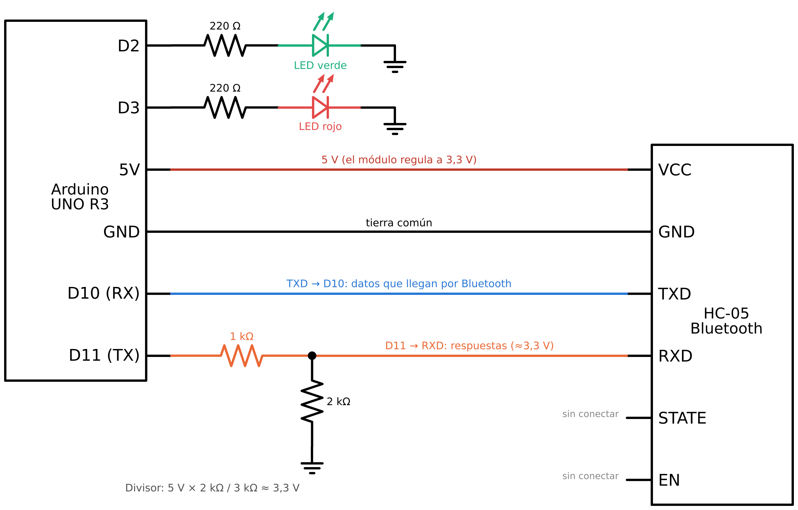
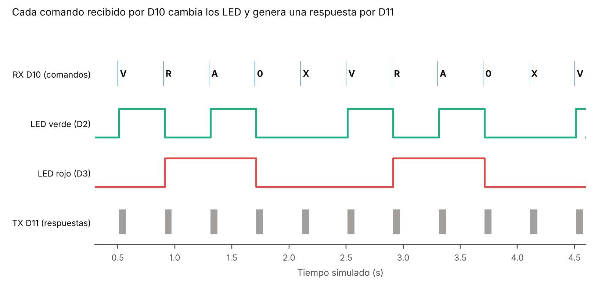
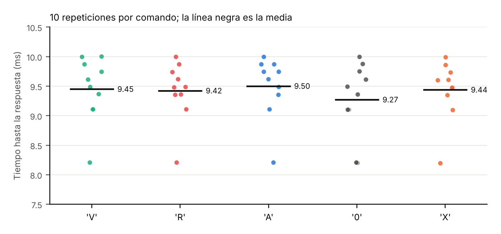

# Control de dos LED por Bluetooth (HC-05) con Arduino UNO

Proyecto de la **Entrega 2** del módulo *Internet de las Cosas* — Politécnico Grancolombiano.
Grupo B03, Subgrupo 12: Daniel Steven Agudelo Galeano, Guadalupe Bedoya Betancur, Miguel Eduardo Colmenares Vela y Fabián Estiben Romero Villamil.
Docente: Ing. Jesús Antonio Figueroa Guerrero.

- **Simulación en Wokwi:** https://wokwi.com/projects/481533776987858945
- **Código fuente:** [`sketch/sketch.ino`](sketch/sketch.ino)
- **Circuito para Wokwi:** [`sketch/diagram.json`](sketch/diagram.json)

## Qué hace

Un Arduino UNO recibe comandos de un carácter a través de un módulo Bluetooth HC-05, que funciona como un puente UART transparente a **9600 baudios (8N1)**, y controla dos LED:

| Comando | Acción | LED verde (D2) | LED rojo (D3) |
|---|---|---|---|
| `V` | Enciende el verde | ON | OFF |
| `R` | Enciende el rojo | OFF | ON |
| `A` | Enciende ambos | ON | ON |
| `0` | Apaga ambos | OFF | OFF |
| otro | Responde `ERROR: comando 'X' no valido` | sin cambio | sin cambio |

Se aceptan minúsculas, y se ignoran los espacios y los fines de línea (`\r`, `\n`). Cada comando recibe una respuesta con marca de tiempo, por ejemplo `[t=512 ms] OK V: LED verde encendido. verde=ON rojo=OFF`. Además, por el puerto USB se publica un registro CSV: `LOG,t_ms,origen,comando,resultado,verde,rojo`.

## Conexiones



| HC-05 | Arduino UNO | Nota |
|---|---|---|
| VCC | 5V | El módulo regula internamente a 3,3 V |
| GND | GND | Tierra común |
| TXD | D10 (RX de SoftwareSerial) | Los 3,3 V del HC-05 se leen como nivel alto |
| RXD | D11 (TX de SoftwareSerial) a través de un divisor 1 kΩ / 2 kΩ | Baja los 5 V de Arduino a ≈3,3 V |
| — | D2 → 220 Ω → LED verde → GND | |
| — | D3 → 220 Ω → LED rojo → GND | |

Se usa SoftwareSerial en D10 y D11 para dejar libre el puerto serie por hardware (D0/D1), que comparte el conversor USB. Así se puede cargar el programa y ver el registro sin desconectar el módulo.

## Cómo probarlo en Wokwi

El circuito incluye un **analizador lógico de 8 canales** que registra, a lo largo de toda la simulación, los comandos que llegan por D10, las respuestas que salen por D11, los dos LED y el registro USB (D1). Con esa captura se miden los tiempos y se construyen las gráficas, sin instrumentos externos.

### En el navegador

1. Abre el enlace público del proyecto, o crea un proyecto **Arduino Uno** nuevo y pega `sketch.ino` y `diagram.json`.
2. Presiona ▶. En el monitor serial aparece `Sistema listo...`.
3. Escribe `V`, `R`, `A`, `0` o `X` y presiona Enter. La respuesta aparece con el prefijo `BT> `, seguida de la línea de registro `LOG,...`.
4. Al detener la simulación, el navegador descarga `captura_bt.vcd`. Puedes abrirla en PulseView o analizarla con `python3 pruebas/wokwi/analizar_vcd.py captura_bt.vcd`.

### Automatizado con wokwi-cli

[`pruebas/wokwi/ejecutar_wokwi.sh`](pruebas/wokwi/ejecutar_wokwi.sh) compila el sketch con `arduino-cli` y lo ejecuta en el simulador de Wokwi con el escenario [`sketch/escenario_pruebas.yaml`](sketch/escenario_pruebas.yaml). El escenario envía 55 líneas a intervalos constantes de 400 ms: las cinco pruebas repetidas 10 veces y cinco casos límite. Después de cada línea verifica con `expect-pin` que D2 y D3 tengan el estado esperado. Al terminar, el script analiza la captura y deja los resultados en `pruebas/wokwi/resultados/`:

- `resultados_por_comando.csv` y `estadisticas_latencia.csv`
- `registro_serial_wokwi.txt`, `registro_bt.txt` y `registro_usb.txt`
- `captura_bt.vcd`
- las gráficas

Para usarlo necesitas un token de Wokwi CI, que se crea en el panel de Wokwi. Las instrucciones de instalación están al inicio del script.

**Limitación del simulador:** ni Wokwi ni Tinkercad emulan el enlace de radio Bluetooth ni incluyen el módulo HC-05. Como el HC-05 entrega los datos a Arduino como bytes UART sin modificarlos, en `diagram.json` la salida del monitor serial se conecta a **D10**, el pin donde el HC-05 entrega lo que escribe el celular. Arduino recibe así exactamente los mismos bytes, por el mismo pin y a la misma velocidad que en el montaje real.

En las pruebas se comprobó que el monitor serial de Wokwi envía correctamente por D10 pero no muestra lo que Arduino transmite por SoftwareSerial en D11. Por eso, la entrada del monitor se conecta a **D1** (puerto USB), y el programa replica allí, con el prefijo `BT> `, cada respuesta que envía por D11. La señal real de D11 queda registrada con el analizador lógico, y de ella salen las mediciones.

## Verificación independiente (simavr)

Como comprobación cruzada con un segundo simulador, en [`pruebas/simavr`](pruebas/simavr) hay un banco de pruebas que ejecuta el firmware compilado en **simavr** (ATmega328P a 16 MHz). El banco transmite cada comando bit a bit por D10 a 9600 baudios, como lo haría el HC-05, decodifica las respuestas en D11 y registra los LED.

- **55 líneas enviadas:** las 5 pruebas obligatorias repetidas 10 veces cada una, más 5 casos límite (`v` en minúscula, ` A` con espacio inicial, `Z`, `7` y `0` sin fin de línea).
- **55 de 55 con el resultado esperado.** Tiempo medio desde el fin del comando hasta la respuesta: 9,4 ms (entre 8,2 y 10,0 ms).
- **Resultados:** [`resultados_por_comando.csv`](pruebas/simavr/resultados_por_comando.csv) y [`estadisticas_latencia.csv`](pruebas/simavr/estadisticas_latencia.csv). El registro serial crudo está en [`registro_serial_usb.txt`](pruebas/simavr/registro_serial_usb.txt).
- **Para reproducirlo** (Linux): `pruebas/simavr/ejecutar.sh`.




### Hallazgo: SoftwareSerial es semidúplex

En la primera versión, Arduino respondía apenas llegaba el carácter. Los `\r\n` que la terminal envía justo después llegaban mientras Arduino transmitía, porque SoftwareSerial desactiva las interrupciones al transmitir. Esos bytes se corrompían y producían errores falsos (`0x14`). La versión final acumula la línea y la procesa tras **10 ms de silencio**, con lo que se eliminaron los errores falsos.

## Estructura

```
sketch/            sketch.ino, diagram.json, wokwi.toml y escenarios de prueba de Wokwi
pruebas/wokwi/     ejecución automatizada en Wokwi, analizador de la captura y resultados
pruebas/simavr/    verificación independiente: banco de pruebas, guion, registros y resultados
evidencias/        gráficas, esquema de conexiones y capturas de la simulación
```

## Condiciones de las pruebas

- **Arduino IDE 2.3.11 (macOS):** el sketch compila para Arduino UNO con 4 946 bytes de flash (15 %) y 358 bytes de SRAM (17 %). Ver [`evidencias/ide`](evidencias/ide).

- **Wokwi:** navegador Safari en macOS, Arduino UNO simulado, monitor serial con fin de línea CRLF.
- **simavr 1.6:** núcleo oficial ArduinoCore-avr, avr-gcc 7.3.0 y `-Os`. El programa ocupa 5 954 bytes de flash (18,2 %) y 371 bytes de SRAM (18,1 %).
